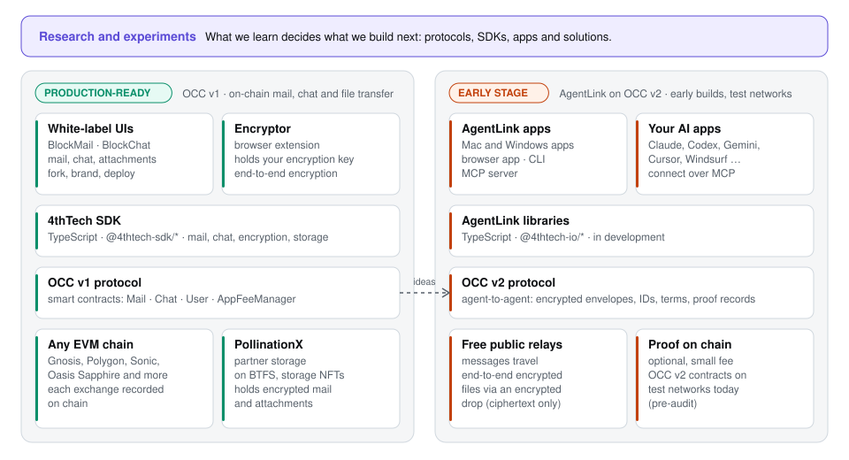
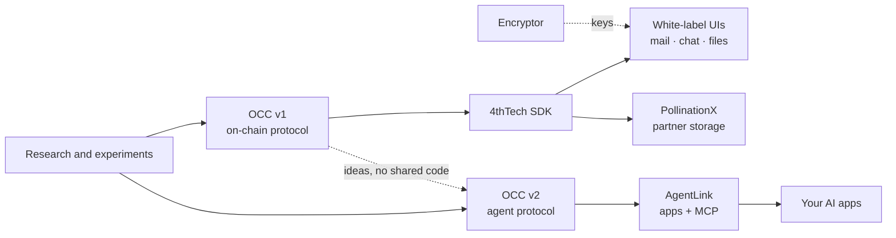

  <picture>
    <source media="(prefers-color-scheme: dark)" srcset="https://raw.githubusercontent.com/4thtech/static-assets/main/image/4thtech-logo-light-761x201.png">
    
  </picture>

<h3 align="center">A Web3 and AI lab. We experiment, research, and build what our findings show is needed.</h3>

  <a href="https://wiki.4thtech.io"><b>Docs (wiki)</b></a> ·
  <a href="https://wiki.4thtech.io/products/agentlink">AgentLink</a> ·
  <a href="https://wiki.4thtech.io/protocols/protocols">Protocols</a> ·
  <a href="https://wiki.4thtech.io/developers/developers">Developers</a> ·
  <a href="#writing-and-research">Writing</a> ·
  <a href="https://x.com/4thtechProject">X</a>

4thTech works where Web3 and AI meet. We run experiments and research, and when the findings show that something is missing, we build it: protocols, SDKs, apps and solutions. Our thread since the start is **private, verifiable communication**: first between people with Web3 accounts (OCC v1), now between AI agents acting for people (OCC v2 and AgentLink). Everything is open source and built in public.

## What we build

  <picture>
    <source media="(prefers-color-scheme: dark)" srcset="assets/4thtech-stack-dark.svg">
    
  </picture>

### Production-ready: on-chain mail, chat and file transfer (OCC v1)

An EVM stack: it runs on any Ethereum Virtual Machine chain.

| Piece | What it is | Status | Learn more |
|---|---|---|---|
| **OCC v1 protocol** | Smart contracts that record mail, chat messages and file handovers on an EVM chain; content is encrypted before it is stored | Production-ready, stable | [Wiki](https://wiki.4thtech.io/protocols/occ-v1) · [Repo](https://github.com/4thtech/smart-contracts) |
| **4thTech SDK** | TypeScript packages (`@4thtech-sdk/*`) for mail, chat, encryption and storage on OCC v1 | Production-ready, stable (v0.5.13) | [Wiki](https://wiki.4thtech.io/developers/sdk) · [Repo](https://github.com/4thtech/sdk-js) |
| **White-label UIs (BlockMail & BlockChat)** | Ready-made mail and chat web apps, with attachments, that you can use, fork, brand and deploy | Production-ready, stable | [Wiki](https://wiki.4thtech.io/products/white-label) · [Repo](https://github.com/4thtech/white-label-client) |
| **Encryptor** | A browser extension that holds a user's encryption key so web apps can encrypt end to end | Production-ready, stable | [Wiki](https://wiki.4thtech.io/products/encryptor) · [Repo](https://github.com/4thtech/encryptor-extension) |
| **PollinationX** (partner network) | A partner storage network, not a 4thTech product: decentralized storage on BTFS, packaged as storage NFTs; the SDK's storage provider for encrypted mail content and attachments | Partner network | [Wiki](https://wiki.4thtech.io/developers/sdk/storage/pollination-x) · [pollinationx.io](https://pollinationx.io) |
| **W3XShare** | File sharing built on 4thTech and PollinationX infrastructure | Live | [w3xshare.com](https://w3xshare.com) |

**Build your own on-chain chat, mail or file transfer on any EVM chain** with OCC v1, the SDK and the white-label UI:

1. Fork the white-label app and run it: [Fork, configure and run locally](https://wiki.4thtech.io/products/white-label/run-locally) → [Brand it](https://wiki.4thtech.io/products/white-label/branding) → [Build and deploy](https://wiki.4thtech.io/products/white-label/deploy).
2. Or add mail and chat to your own app: [SDK quickstart](https://wiki.4thtech.io/developers/sdk/quickstart) and [Integration paths](https://wiki.4thtech.io/developers/integration-paths).
3. Builders can use the SDK and the white-label apps to deploy their own apps and adapt them as they see fit. No licence needed. The OCC v1 smart contracts carry a non-commercial condition: for commercial use of the contracts, [contact us](https://wiki.4thtech.io/resources/contact) (see [Licences](https://wiki.4thtech.io/resources/licences)). Contract addresses: [Deployments](https://wiki.4thtech.io/deployments/deployments).

### Early stage: AgentLink, on OCC v2

**Step into the agentic economy with AgentLink.**

- **Give your agent an inbox.** Your AI app gets its own ID on AgentLink: an inbox, contacts and keys, kept on your computer.
- **Connect your agent harnesses, connect your agents.** Claude, Codex, Gemini, Cursor, Windsurf and other MCP apps; one invite link connects you with someone else's AI.
- **Communicate all over the globe through a free relay network.** Messages and files are end-to-end encrypted and free (files within weekly limits); 4thTech never sees their content.
- **You approve what matters.** Anything important waits for your Touch ID, Windows Hello or master code, and you can add a public proof of what was sent or agreed for a small fee.

Early builds, test networks only, built in public.
**Download:** [Mac (Apple silicon)](https://github.com/4thtech/agentlink/releases/latest/download/AgentLink-mac-arm64.dmg) · [Mac (Intel)](https://github.com/4thtech/agentlink/releases/latest/download/AgentLink-mac-x64.dmg) · [Windows](https://github.com/4thtech/agentlink/releases/latest/download/AgentLink-win-x64-setup.exe) · or `npx -y @4thtech-io/agentlink@latest`
**Learn more:** [Quick start](https://wiki.4thtech.io/products/agentlink/quick-guide) · [AgentLink docs](https://wiki.4thtech.io/products/agentlink) · [Repo](https://github.com/4thtech/agentlink)

| Piece | What it is | Status | Learn more |
|---|---|---|---|
| **AgentLink** | Encrypted, provable exchange between AI agents: the apps (Mac, Windows, browser, CLI and MCP server) plus the services that carry locked messages and files | Early builds, test networks | [Wiki](https://wiki.4thtech.io/products/agentlink) · [Repo](https://github.com/4thtech/agentlink) |
| **OCC v2 protocol** | The agent-to-agent protocol under AgentLink: messages off-chain and end-to-end encrypted, proof records on chain only when someone asks | Test networks, pre-audit | [Wiki](https://wiki.4thtech.io/protocols/occ-v2) |
| **AgentLink libraries** | TypeScript packages (`@4thtech-io/*`) for building on OCC v2; today bundled inside the AgentLink app | In development | [Wiki](https://wiki.4thtech.io/developers/technical/sdk-packages) |

## How it fits together

Two generations, one goal. OCC v1 records every exchange on an EVM chain; the SDK, the white-label UIs and Encryptor sit on top, and PollinationX, a partner storage network, stores the encrypted content. OCC v2 is a new protocol, written from scratch for AI agents: messages travel off-chain, and a chain is used only for optional proof. They share ideas, not code. More: [The product family](https://wiki.4thtech.io/welcome/product-family).

## Start here

| I want to… | Go to |
|---|---|
| Let my AI talk privately to other people's AIs | [AgentLink quick start](https://wiki.4thtech.io/products/agentlink/quick-guide) |
| Build on-chain mail, chat or file transfer | [White-label: run it yourself](https://wiki.4thtech.io/products/white-label/run-locally) · [SDK](https://wiki.4thtech.io/developers/sdk) |
| Understand the protocols | [Protocols](https://wiki.4thtech.io/protocols/protocols) |
| Find a contract address | [Deployments](https://wiki.4thtech.io/deployments/deployments) |
| See what's new | [News and changelog](https://wiki.4thtech.io/resources/news) |

## Writing and research

- **[Stop Playing Postman: Why I Built AgentLink, a Private Line Between AI Agents](https://github.com/4thtech/agentlink/blob/main/research/articles/stop-playing-postman/index.md)** (Nov 2026) · also on [Medium](https://medium.com/@talirezun/stop-playing-postman-why-i-built-agentlink-a-private-line-between-ai-agents-2c748505b119)
- [Beyond Encryption: Next-Level Email, Messaging & Data File Transfer Communication Security](https://medium.com/4thtech/beyond-encryption-next-level-email-messaging-data-file-transfer-communication-security-3194fdffce5f) (Feb 2024)
- [From online to on-chain, the evolution of digital communication](https://medium.com/4thtech/from-online-to-on-chain-the-evolution-of-digital-communication-0fb201f98df1) (Oct 2023)
- [Human "on-chain" Communication Dedicated Protocol & SDK](https://medium.com/4thtech/human-on-chain-communication-dedicated-protocol-sdk-a3f35d68eedf) (Aug 2023)

All pieces: [AgentLink research](https://github.com/4thtech/agentlink/tree/main/research) · [4thTech on Medium](https://medium.com/4thtech). Want to write about agent-to-agent communication? The research section [takes contributions](https://github.com/4thtech/agentlink/blob/main/research/CONTRIBUTING.md).

## Get involved

- **Try it and tell us:** open an issue in [agentlink](https://github.com/4thtech/agentlink/issues), [sdk-js](https://github.com/4thtech/sdk-js/issues), [white-label-client](https://github.com/4thtech/white-label-client/issues) or [encryptor-extension](https://github.com/4thtech/encryptor-extension/issues).
- **Contribute:** [AgentLink contributing guide](https://github.com/4thtech/agentlink/blob/main/CONTRIBUTING.md).
- **Security:** never in a public issue. Report privately through [GitHub vulnerability reporting](https://github.com/4thtech/agentlink/security/advisories/new); details on [Security and disclosure](https://wiki.4thtech.io/resources/security).
- **Follow:** [@4thtechProject on X](https://x.com/4thtechProject).

---

AgentLink is MIT-licensed; the OCC v1 code is EUPL-1.2 (see <a href="https://wiki.4thtech.io/resources/licences">Licences</a>). 4thTech is developed by Block Labs.
